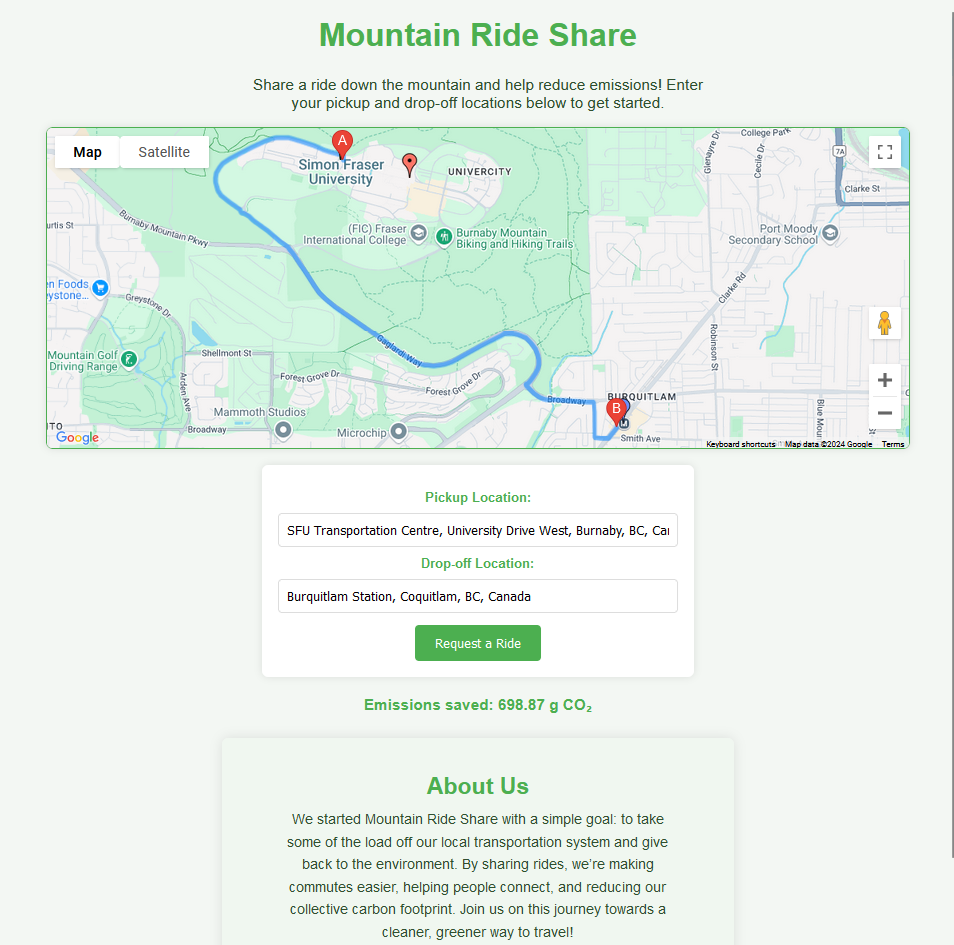
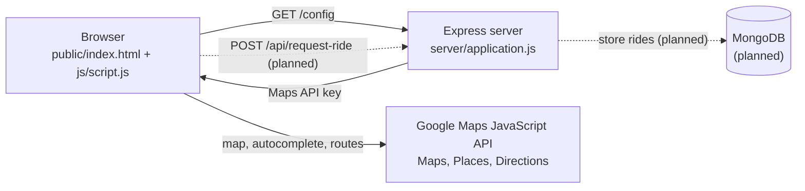
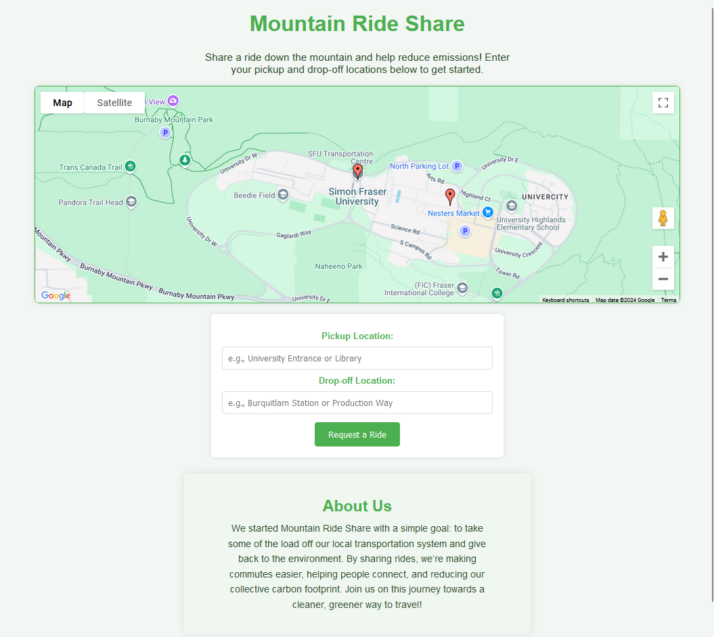
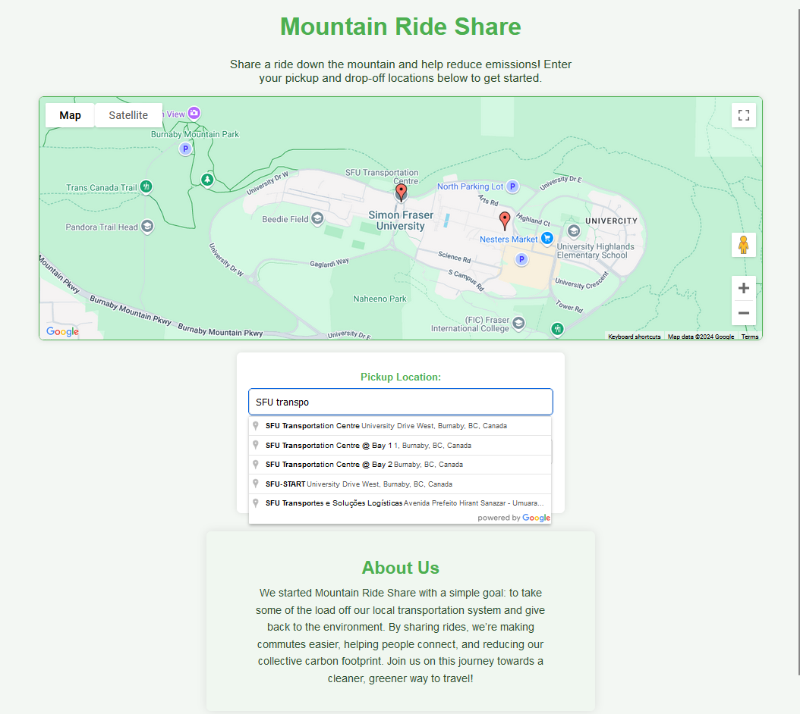

# Mountain Ride Share


A web app for sharing rides down Burnaby Mountain (SFU). Riders pick a pickup on the mountain and a
drop-off in Metro Vancouver, see the driving route on a map, and get an estimate of the CO₂ they
avoid by sharing a ride instead of driving alone.



## Why

SFU's Burnaby campus sits on top of a mountain, and most people get up and down it by bus. At busy
times those buses fill up. Mountain Ride Share explores matching people who are driving down anyway
with people who need a ride, taking load off transit and cutting emissions.

## Current status

This is a working front-end prototype on an Express backend. The ride-matching API is designed but
not implemented yet (see [Roadmap](#roadmap)).

| Area                                        | Status         |
| ------------------------------------------- | -------------- |
| Map with Burnaby Mountain transit stops     | ✅ Working     |
| Pickup / drop-off search with autocomplete  | ✅ Working     |
| Route planning and display                  | ✅ Working     |
| Service-area validation                     | ✅ Working     |
| CO₂ avoided estimate                        | ✅ Working     |
| Ride request / accept API (`/api/*`)        | 🚧 Stubs (501) |
| Accounts, ride persistence, driver matching | 🗺️ Planned     |

## Features

- **Interactive map** centred on SFU, with markers for the main transit stops on the mountain.
- **Places autocomplete** for pickup and drop-off, biased to Metro Vancouver.
- **Route planning** with the Google Directions service, drawn directly on the map.
- **Service-area rules**: pickups must be within 2.5 km of SFU and drop-offs inside Metro
  Vancouver, with clear inline error messages.
- **Emissions estimate**: trip distance × an assumed 121.5 g CO₂/km for an average car, i.e. the
  emissions a rider avoids by not driving the trip alone.

## How it works



1. The Express server serves the static front end and exposes `GET /config`, which returns the Maps
   API key from the environment, so the key never lives in the source code.
2. The browser loads the Google Maps script with that key and initialises the map and autocomplete.
3. On **Request a Ride**, the Directions service plans the route. The client checks the service
   area, draws the route and shows the CO₂ estimate.

## Design decisions

- **Secrets stay in the environment.** Keys are read from `.env` (git-ignored), and `.env.example`
  documents what is needed. The Maps JavaScript API key is necessarily visible to the browser, so
  it should be restricted to your domain with an HTTP-referrer restriction in Google Cloud.
- **Honest API surface.** Unimplemented endpoints return `501 Not Implemented` rather than a fake
  success response.
- **Runs without a database.** MongoDB is only connected when `MONGO_URI` is set, so the front end
  can be developed without one.
- **Accessible feedback.** Errors and results appear in an `aria-live` status region instead of
  blocking `alert()` dialogs.

## Tech stack

- **Frontend:** HTML5, CSS3, vanilla JavaScript
- **Backend:** Node.js, Express
- **Database:** MongoDB with Mongoose (connection in place, models planned)
- **APIs:** Google Maps JavaScript API (Maps, Places, Directions)
- **Tooling:** ESLint, Prettier, EditorConfig

## Getting started

### Prerequisites

- [Node.js](https://nodejs.org/) 18.11 or newer
- A Google Maps JavaScript API key with the Places and Directions APIs enabled
  ([Google Cloud Console](https://console.cloud.google.com/))
- Optional: a MongoDB connection string, e.g. a free [MongoDB Atlas](https://www.mongodb.com/atlas)
  cluster. Not needed for the current features.

### Installation

1. **Clone the repository**

    ```bash
    git clone https://github.com/kza40/MountainRideShare.git
    cd MountainRideShare
    ```

2. **Install dependencies**

    ```bash
    npm install
    ```

3. **Configure environment variables.** Copy the example file and fill in your own values:

    ```bash
    cp .env.example .env
    ```

    | Variable              | Required | Description                              |
    | --------------------- | -------- | ---------------------------------------- |
    | `GOOGLE_MAPS_API_KEY` | Yes      | Google Maps JavaScript API key           |
    | `MONGO_URI`           | No       | MongoDB connection string                |
    | `PORT`                | No       | Port for the server (defaults to `3000`) |

4. **Start the server**

    ```bash
    npm start
    ```

    Then open http://localhost:3000.

### Scripts

| Command                | Description                                  |
| ---------------------- | -------------------------------------------- |
| `npm start`            | Start the server                             |
| `npm run dev`          | Start the server and restart on file changes |
| `npm run lint`         | Lint with ESLint                             |
| `npm run format`       | Format with Prettier                         |
| `npm run format:check` | Check formatting without writing changes     |

## Project structure

```
.
├── public/              # Static front end served by Express
│   ├── index.html
│   ├── css/styles.css
│   └── js/script.js     # Map, autocomplete, routing, validation, CO₂ estimate
├── server/
│   ├── application.js   # Express app: static files, /config, MongoDB connection
│   └── routes.js        # /api ride endpoints (stubs)
├── docs/images/         # Screenshots used in this README
├── .env.example         # Template for required environment variables
└── eslint.config.js     # Lint rules for browser and Node code
```

## Screenshots

| Landing page                                  | Place autocomplete                            |
| --------------------------------------------- | --------------------------------------------- |
|  |  |

## Roadmap

- [ ] `Ride` and `User` models in MongoDB; persist ride requests from `POST /api/request-ride`
- [ ] Driver view listing open requests, with `POST /api/accept-ride`
- [ ] Accounts with rider and driver roles (e.g. SFU email sign-up)
- [ ] Real-time ride status updates (e.g. Socket.IO)
- [ ] Server-side validation of the service area and request payloads
- [ ] API tests (Jest + Supertest) and a GitHub Actions CI workflow
- [ ] Community total of CO₂ avoided across all shared rides

## License

[MIT](LICENSE) © Kiarash Zamani
